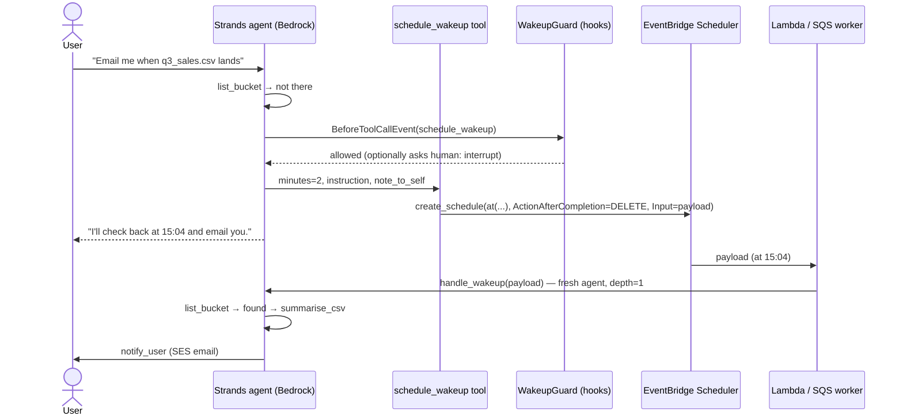

# ⏳ Patience — give your agent the ability to wait

> **AWS Builder Center Weekend Challenge: Give your Agent a Tool** (Oct 2026)
> One new tool, `schedule_wakeup`, built on **Amazon EventBridge Scheduler**, lets a
> **Strands Agents** + **Amazon Bedrock** agent do something agents almost never can:
> **come back later, on its own, and finish the job.**

Every agent lives inside a single request. Ask it to do something that depends on the
future ("email me when the file lands", "check again in an hour", "remind me tomorrow")
and the best it can do is tell *you* to come back. The agent has no sense of time.

`schedule_wakeup` gives it one. The model decides **when** to come back and **writes the
instructions for its future self**. EventBridge Scheduler books a one-shot schedule that
re-invokes the agent at that time with those instructions. The agent wakes up, re-checks
the world with its normal tools, and then either finishes or goes back to sleep.

---

## Before / after

**The agent:** *Kopi*, a small data assistant for a Malaysian F&B company. Before this
challenge it already had three tools: `list_bucket` (S3), `summarise_csv`, `notify_user` (SES).

**Same prompt, both versions:**
> *"Finance is uploading q3_sales.csv this afternoon. When it lands, email me revenue by region."*

| | BEFORE (3 tools) | AFTER (+ `schedule_wakeup`) |
|---|---|---|
| Turn 1 | Lists the bucket, sees no file. *"The file isn't there yet. Please ask me again once it's uploaded."* | Lists the bucket, sees no file, **schedules itself 2 min out** with a note: *"User wants revenue by region from q3_sales.csv; at 15:02 it was missing."* |
| Meanwhile | Nothing happens. The human has to remember. | ⏰ Wakes, still missing → **reschedules itself** (wake #2) |
| File lands | Nothing happens. | ⏰ Wakes, finds the file, summarises it, **emails the result**, stops scheduling |
| Who did the waiting? | You | The agent |

Run it yourself: `python -m patience.cli --before "..."` vs `python -m patience.cli "..."`.

---

## How it works



**The payload is the agent's memory.** A woken agent is a brand-new process that remembers
nothing, so the tool forces the model to write `instruction` + `note_to_self`. That turns
out to be a clean, serverless way to carry state across time with no database at all.

### Design details (the "craft")

| Concern | How it's handled |
|---|---|
| Runaway loops | `PATIENCE_MAX_DEPTH` (default 6) chained wake-ups per task; the tool returns an error telling the model to stop and report. |
| Lazy sleeping | `WakeupGuard` hook **cancels** `schedule_wakeup` on a wake-up turn if the agent hasn't re-checked anything first. |
| Too far ahead | `minutes_from_now` capped (default 7 days). |
| Duplicate schedules on retries | Deterministic schedule name `patience-<chain>-d<depth>`; `ConflictException` treated as success. |
| Clean-up | One-shot `at()` schedules with `ActionAfterCompletion=DELETE` — nothing to garbage-collect. |
| Delivery failures | Scheduler `RetryPolicy` (2 retries, 1 h max age). |
| Human oversight | `PATIENCE_REQUIRE_APPROVAL=1` → Strands **interrupt** asks the user before the agent books a wake-up. |
| Least privilege | Agent may only `scheduler:CreateSchedule` in its own group and `iam:PassRole` one role; that role may only invoke one Lambda / send to one queue. |
| Testability | `PATIENCE_DRY_RUN=1` + a scripted Strands `Model` → the whole sleep/wake/finish loop is tested offline (`pytest`). |

---

## Reuse it in your own agent (3 lines)

```python
from strands import Agent
from patience.wakeup import schedule_wakeup, WakeupGuard

agent = Agent(tools=[*your_tools, schedule_wakeup], hooks=[WakeupGuard()])
agent("Tell me when the deploy finishes",
      invocation_state={"wake_depth": 0, "chain_id": "abc123", "original_task": "..."})
```

Then point a schedule target at anything that calls `patience.agent.handle_wakeup(payload)`
(see `lambda_fn/handler.py` — 10 lines) and deploy `template.yaml`. That's the whole pattern:
**one `@tool`, one hook, one Lambda, one IAM role.**

Things this unlocks for *any* agent: waiting on uploads, polling a deploy/build/job,
"remind me tomorrow", retry-with-backoff after a rate limit, watching a price or metric,
following up on an unanswered email.

---

## Run it

Prereqs: Python 3.12+, AWS CLI credentials, [AWS SAM CLI](https://docs.aws.amazon.com/serverless-application-model/latest/developerguide/install-sam-cli.html), Bedrock access to **Amazon Nova Pro** in `us-east-1` (or set `--parameter-overrides ModelId=...`).

```bash
pip install -r requirements.txt

# offline tests (no AWS needed)
python -m pytest -q

# deploy: bucket, wake queue, schedule group, scheduler role, wake Lambda
sam build
sam deploy --guided --stack-name patience --region us-east-1 --capabilities CAPABILITY_IAM

# write .env from the stack outputs
#   --target sqs    → wake-ups go to a queue drained by a local worker (best for a live demo)
#   --target lambda → wake-ups run in Lambda (fully serverless)
python scripts/configure.py --stack patience --region us-east-1 --target sqs
```

**Demo (two terminals):**

```bash
# terminal 1 — the agent's "alarm clock"
python -m patience.worker

# terminal 2
python scripts/drop_file.py --remove
python -m patience.cli --before "Finance is uploading q3_sales.csv this afternoon. When it lands, email me revenue by region."
python -m patience.cli          "Finance is uploading q3_sales.csv this afternoon. When it lands, email me revenue by region."
# …watch terminal 1 wake up and reschedule, then:
python scripts/drop_file.py
```

**Email (optional):** verify an address in SES (sandbox is fine if sender = recipient), then
`python scripts/configure.py ... --notify-from you@x.com --notify-to you@x.com`.
Without it, `notify_user` prints to the console.

**Before/after eval on real Bedrock:** `python scripts/eval_before_after.py`

**Clean up:** `sam delete --stack-name patience` (empty the bucket first).

---

## Repo layout

```
patience/wakeup.py       ← the new tool + WakeupGuard hook (the submission)
patience/base_tools.py   ← the agent's original tools (before)
patience/agent.py        ← build_agent / run_task / handle_wakeup
patience/cli.py          ← talk to the agent (--before for the old version)
patience/worker.py       ← local SQS wake-up worker
lambda_fn/handler.py     ← Lambda wake-up entry point
template.yaml            ← SAM: S3, SQS, Scheduler group + role, Lambda
tests/                   ← offline tests with a scripted Strands model
scripts/                 ← configure, demo file drop, before/after eval
docs/                    ← submission write-up + demo video script
```

## AWS services used
Amazon Bedrock (Nova Pro) · **Amazon EventBridge Scheduler** · AWS Lambda · Amazon SQS · Amazon S3 · Amazon SES · AWS IAM · AWS SAM/CloudFormation

MIT licensed.
